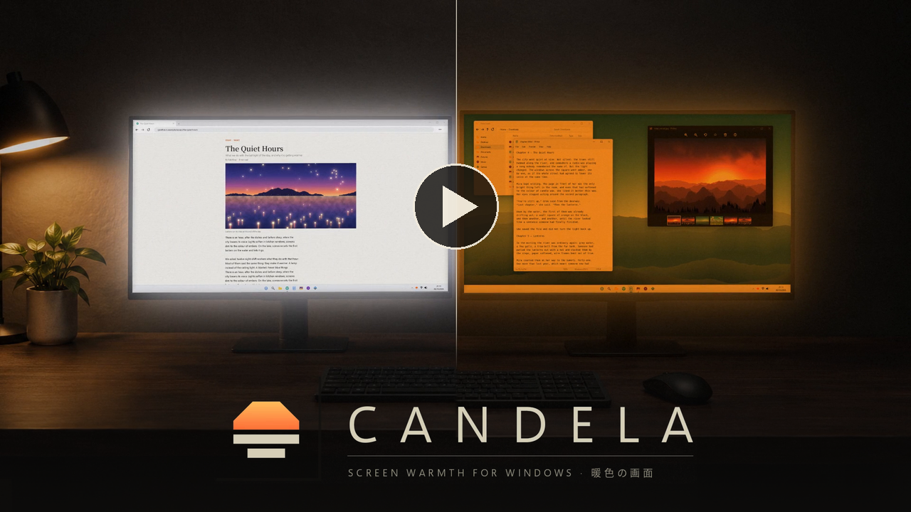

# Candela

**Screen warmth for Windows that follows the sun**, with an Alt+Tab switcher and a volume and media popup to match. One small `candela.exe`: nothing to install, and it never connects to the internet.

<p align="center">
  <a href="https://youtu.be/HRTi-FU-7Gc">
    
  </a>
</p>

<p align="center">
  <a href="https://github.com/Haise-d/candela/releases/latest"><b>Download the latest release</b></a> · Windows 10 and 11 (64-bit) · English and 日本語
</p>

> [!WARNING]
> **Out of the box, Windows won't let Candela go warmer than 3400K. Your screen won't get really orange until you do these 2 steps once.**
>
> 1. **Unlock.** The first time Candela starts, it asks. Click **Yes**, then **Yes** again when Windows asks.
>    Missed it? Right-click the sun icon in the tray and choose **Unlock warm colors**.
> 2. **Restart your PC.** Candela offers to do it for you. Or later: Start, then Power, then **Restart** (not Shut down, and not signing out: neither counts).
>
> **Step 2 is the one people skip.** Until you restart, Candela can't go warmer than about 3400K, or dim much below half: it puts on the closest Windows allows. It isn't broken, it's waiting for the restart, and it says **RESTART** at the bottom of its settings until you do.
>
> Already did this for Candela mini or f.lux on this PC? Then you're done.

Only want the warmth? **[Candela mini](https://github.com/Haise-d/candela-mini)** is Candela, but simpler: the same warmth, without the switcher, the popups and the animations.

## What it does

- **Warmth on a schedule.** A day color, a warmer one from sunset, and at night either a warmer color still or **Afterglow**. Sunrise and sunset are worked out on your PC from your town's coordinates, with Windows' own daylight saving.
- **Afterglow.** The whole screen in red, by brightness: the gentlest light for a dark room. Text in any color stays readable, because every pixel becomes a red of its own brightness.
- **It stays warm.** Games and graphics drivers sometimes reset the screen's colors. Candela notices within a tenth of a second and puts them back.
- **Hotkeys.** Warmer, cooler, dimmer, brighter, Afterglow, warmth off for a film, and two window tools: make a window borderless, and black out every screen but the one you're using.
- **Alt+Tab, reworked.** A list of your windows with a live preview of the selected one. Close windows right from the list, and keep the switcher on one screen if you like.
- **Volume and media popup.** It replaces Windows' volume flyout: the level when the volume changes (from the keys, a headset, a volume knob or Windows' slider), and the song, artist, cover and progress for the media keys and when a new song starts.
- **A look of its own.** Dark panels that glitch open and closed, with full or subtle animation (or none), two palettes, matching cursors and Windows' dark mode in one click.
- **Stays out of games.** No popups over the games you list, and it lets go of the keyboard entirely while an anti-cheat game you list is running.

## Getting started

1. **Turn off Windows Night Light, and quit f.lux** or any other screen-warmth app. Two programs changing the screen's colors fight each other.
2. **Unzip** the download somewhere permanent and keep the `theme` folder next to `candela.exe`. `C:\Program Files\Candela` is the best place (see [Start with Windows](#start-with-windows)).
3. **Run `candela.exe`.** It isn't code-signed, so Windows SmartScreen may warn about an unknown app: choose **More info → Run anyway**.
4. **Unlock warm colors, then restart.** Right away it asks to unlock warm colors: click **Yes**, then **Yes** again when Windows asks. Then let it restart your PC, or restart yourself later. Until you do, it goes no warmer than about 3400K (see [Warm colors](#warm-colors)).
5. **Set your town.** The settings open on **Latitude** the first time, and again after the restart until it's set. In Google Maps, right-click your town and click the coordinates at the top of the menu to copy them, then paste them into either field.
6. Optionally, turn on **Start with Windows** and **In the Start menu** on the **System** page.

Candela lives in the tray, as a small sun tinted with the warmth on screen (it may be under the **^** arrow). **Click** it for the settings, **right-click** it for a quick menu. Running `candela.exe` again while it's running also opens the settings.

## The settings

The settings window shows today's schedule across the top, each part in the color it puts on screen, with the switch times underneath; click a part to jump to its setting. Below that are eight pages:

| Page | What's there |
|---|---|
| **Schedule** | Day and evening colors, a sunset offset, when night starts, Afterglow or a color at night, when the day starts (sunrise or a fixed time), your coordinates |
| **Afterglow** | Afterglow now, its brightness, keep all text readable, invert (for a real photographic darkroom) |
| **Hotkeys** | Every hotkey, how far warmer and cooler move, whether a blackout covers every window |
| **Switcher** | Alt+Tab on or off, dim the screen behind, which screen it opens on, the quick-switch delay, names typing in, icon colors, exclusive-fullscreen games |
| **Popups** | The warmth popup and the volume and media popup, the new song popup and which apps it follows, album covers, the volume step, each popup's corner, buttons to try them |
| **Games** | Games with no popups over them, and anti-cheat games Candela lets go of the keyboard for |
| **Style** | Animation, colors, font, cursors and dark mode |
| **System** | Language, Start with Windows, Start menu, pause everything, today's color-reset count, the settings file and log, quit |

The panel on the right explains whichever setting is selected, with a live preview of the popups where that helps. Hover to select, click to change (right-click goes back), Tab or Page Up/Down for the next page, Esc to close. Everything saves by itself.

## Hotkeys

| Default | What it does |
|---|---|
| Alt+Shift+PgDn | Warmer, 100K at a time (adjustable), down to 900K and then Afterglow |
| Alt+Shift+PgUp | Cooler |
| Alt+Shift+Del | Afterglow now, or leave it |
| Alt+Del | Warmth off (for a film or photo editing), or back on |
| Alt+PgDn / Alt+PgUp | Dimmer / brighter, 10% at a time, down to 10% (below about half only once warm colors are unlocked) |
| Ctrl+Alt+B | Make the window in front borderless and fill its screen, or put it back |
| Ctrl+Alt+N | Black out every screen but the one you're using, or bring them back |

Warmer, cooler, Afterglow and warmth off last until the next scheduled change, then the schedule takes over again. Dimming lasts until the next morning. Every hotkey can be changed; each needs Ctrl, Alt or Win, so a plain key is never taken from your other programs.

**Pause everything** (tray menu or **System**) puts normal colors back and hands Alt+Tab and the volume flyout back to Windows until you turn it off again.

## Alt+Tab

| Keys | What it does |
|---|---|
| Alt+Tab, Alt+Shift+Tab | Open the switcher, then move forward or back |
| Arrows, Home, End | Move (while holding Alt) |
| Delete | Close the selected window (while holding Alt) |
| Release Alt, or Enter | Switch to the selected window |
| Esc | Cancel |
| Mouse | Hover to select, click to switch, click a row's **×** to close that window, click outside to cancel |

A quick Alt+Tab, released within 80 ms, switches straight away without showing anything, like Windows does.

Closing a window works like the taskbar's **Close window**: an app with unsaved work can still ask first, and its question appears in the list. **Switcher → Screen** opens the switcher on the active window's screen (the default), always on the primary screen, or always on a screen you pick.

## Popups

- **Warmth popup:** what a hotkey just did, and how long it lasts.
- **Volume popup:** the level whenever the volume changes, whatever changed it. Windows' own flyout is replaced for the volume keys; a headset or a volume knob may still show it as well.
- **Song card:** the title, artist, cover and progress, for play/pause, next, previous and stop. With **New song popup** on, it also shows when the next song starts by itself, in Spotify or in apps you add (a browser, foobar2000...): play something in the app, then add it on the **Popups** page.

Each popup has its own corner, or both share one. They never take focus and clicks go through them.

## Games

- **No popups over games.** While a game from this list is in front, or anything in exclusive fullscreen, the keys keep working but nothing is drawn over the game. Add the game in front from the tray menu, or from **Games** in the settings.
- **Let go for anti-cheat.** While a game from the anti-cheat list is running, even minimized, Candela stops watching the keyboard entirely; Windows' own Alt+Tab and volume flyout are back until it closes. The warmth and the hotkeys keep working.
- **Exclusive fullscreen.** Nothing can be drawn over a game in exclusive fullscreen, so Windows handles Alt+Tab there. Use the game's borderless mode to get Candela's switcher, or change **Switcher → Exclusive fullscreen games**.

## Good to know

### Warm colors

Windows refuses colors warmer than about 3400K, and dimming much below half, for every app, unless one registry value is set. It's the same value f.lux and Candela mini set, so if either already did it on this PC, you're done. Until then Candela puts on the closest Windows allows, and the tray icon, its tooltip, the warmth popup and the top of the settings show what's really on screen (for example *~3300K · limited*).

- **To set it:** say **Yes** when Candela asks at its first start, or right-click the tray icon and choose **Unlock warm colors**, or click the warning at the bottom of the settings, or use **System → Allow warm colors**. Windows asks for admin.
- **Then restart Windows.** Windows only picks the value up after a restart, so until the restart Candela goes no warmer than about 3400K however warm you set it. Candela offers to restart for you, and until you do, the settings say **RESTART** at the bottom (click it to restart), the row becomes **Restart to unlock warm colors**, and the tray icon's menu and tooltip say so too. Use **Restart**: Shut down and signing out don't count, and the reminder stays until a real restart. You only do this once per PC.
- **To check it worked:** after the restart, press **Alt+Shift+PgDn** a few times. If the screen keeps getting more orange below 3400K, it's working.

```
HKLM\SOFTWARE\Microsoft\Windows NT\CurrentVersion\ICM   GdiIcmGammaRange = 256 (DWORD)
```

Until the restart, a temporary key `HKLM\SOFTWARE\Candela warm colors pending` remembers that one is still needed. It's kept in memory only, so Windows removes it by itself at the restart.

### Start with Windows

Windows keeps ordinary apps away from admin windows such as Task Manager and installers, so Alt+Tab only works over those if Candela runs as admin. **Start with Windows** registers a scheduled task that starts it as admin when you sign in; Windows asks once, when you turn it on.

That only happens when `candela.exe` sits in a folder only admins can change, such as `C:\Program Files\Candela`, so another program can't swap it for something else. From any other folder, Candela still starts with Windows, just without admin rights.

### Getting normal colors back

Press **Alt+Del**, choose **Pause everything**, or quit. Normal colors come back however Candela ends: quitting, signing out, a crash, or **End task** in Task Manager. You can also run `candela.exe --reset`.

You'll see two `candela.exe` in Task Manager. The second is a tiny guard that only waits; if Candela is ended from outside, the guard puts normal colors back. **End process tree** ends both, and then the warmth stays until you start Candela again or run `candela.exe --reset`.

### Antivirus warnings

Some antivirus tools flag unsigned programs that watch the keyboard. Candela reacts only to Alt+Tab and the volume and media keys, records nothing, and never connects to the internet. The full source is here, and every release is built from it by GitHub Actions. If yours flags it, allow it, and consider reporting a false positive to the antivirus maker.

### Conflicts

Turn off Windows Night Light, f.lux, Candela mini and similar apps: two programs changing the screen's colors fight each other. Also turn off Windows' color filters and Magnifier while you use Candela's Afterglow. To keep text readable, Afterglow uses the same part of Windows they do, and only one of them can use it at a time.

### Settings file and log

Both are in `%APPDATA%\Candela`, and the **System** page opens them.

- **`config.json`** holds every setting. Edits are picked up within a couple of seconds. If a hand edit has a mistake, Candela keeps a copy as `config.json.bad` and carries on with the settings it had. A few rarely needed options live only here:
  - `force_reapply_ms`: for graphics drivers that reset the colors without Candela noticing. Try `250` if you see flashes of full color.
  - `borderless_overhang_px`: for apps that still flicker when made borderless.
  - `dim_step`, `dim_min`: the dimming step and lowest level.
  - `palette: "custom"` with `color_paper`, `color_paper_dark`, `color_ink`, `color_ink_soft` and `color_shade` (as `RRGGBB`): your own colors. For a light look, try paper `D6D0B8`, paper_dark `BCB6A0`, ink `4A473E`, ink_soft `7C7766`.
  - Afterglow's settings use the key names `night_darkroom`, `darkroom_brightness`, `darkroom_by_brightness`, `darkroom_invert` and `hotkey_darkroom`.
- **`candela.log`** notes every color reset Candela fixed (and which app was in front), when it let go of the keyboard for a game, anything Windows refused, and crashes.

### Japanese

**System → Language · 言語** switches everything to Japanese, written like a terse system log (報告：, 推奨：, 警告：). Fontworks' **Rodin** suits it best: it's a commercial font, so it can't ship with Candela, but Candela uses it if it's installed (FOT-Rodin ProN in Adobe Fonts, for example). Otherwise it uses Yu Gothic UI.

### Limits

- Store apps such as Settings or Calculator sometimes have no icon in the switcher.
- An app that doesn't report to Windows' media controls can't show its song.
- Candela doesn't change Windows' own animations, the taskbar or Start.

## Command line

```
candela.exe --settings     run it and open the settings
candela.exe --schedule     show the next few days' switch times
candela.exe --reset        put normal colors back and exit (closes a running Candela first)
candela.exe --do <action>  act like a hotkey in the running Candela: warmer, cooler, off, afterglow,
                           dimmer, brighter, borderless or blackout (for scripts and macro keys)
```

## Uninstalling

Turn off **Start with Windows**, **In the Start menu** and **Cursors and dark mode**, quit Candela from the tray, then delete its folder and `%APPDATA%\Candela`.

## Building from source

Candela is C++17 on the Win32 API, Direct2D and DirectWrite, with no third-party libraries. It builds with MinGW-w64 on Linux, WSL or MSYS2:

```
sudo apt install g++-mingw-w64-x86-64-posix binutils-mingw-w64-x86-64   # Ubuntu / Debian / WSL
CXX=x86_64-w64-mingw32-g++-posix ./build.sh                             # writes out/candela.exe
```

`build.sh` also runs the logic tests in `tests/` when a native `g++` is available. Every push is built by GitHub Actions, and publishing a release attaches `Candela-<version>.zip` to it; the release tag must match `CANDELA_VERSION` in `src/candela.h` (tag `v1.0.0` for 1.0.0).

| Folder | Contents |
|---|---|
| `src/core/` | The logic, with no Windows code: sun times, colors, the schedule, hotkey text, the settings file |
| `src/` | The app: the engine and tray (`engine.cpp`), screen colors (`display.cpp`), the keyboard hook, the switcher, the popups, the settings window, drawing and animation |
| `tests/` | Tests for `src/core/`, run in Madrid's time zone |
| `res/`, `theme/` | The app icon and the cursors |
| `tools/` | Scripts that draw the icon and the cursors (need Python and Pillow) |

`candela.exe --dump <folder>` renders the popups, the switcher, the blackout and the settings window frame by frame to PNG files, for checking the look without a real desktop; it runs under Wine too.

## Planned updates

For whenever I feel inspired:

- Starlit-night theme

## Credits

Made by **Haise**, coworked with **Claude** (Anthropic's AI assistant): designed, written and tested together.

Inspired by years of using [f.lux](https://justgetflux.com/). Candela isn't affiliated with it.

## License

MIT, see [LICENSE](LICENSE). `candela.exe` includes parts of the MinGW-w64 runtime; their notices are in [THIRD_PARTY_NOTICES.md](THIRD_PARTY_NOTICES.md).
